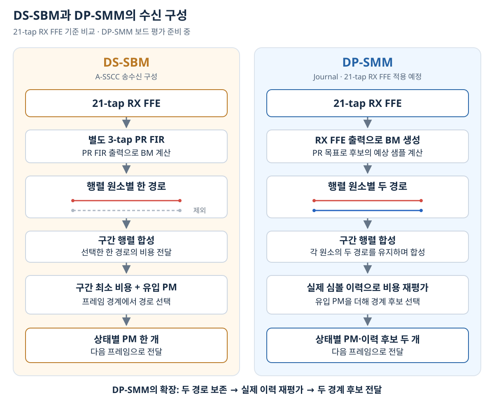

# Journal preparation | DP-SMM PAM4 detector (in progress)

[Portfolio](https://github.com/yunjuhyeong0916-glitch/jhyun/blob/main/README.en.md#page-top) · [Research home](../../README.en.md#page-top) · [Detailed notes (Korean)](README.md#page-top)

DP-SMM retains **two paths per segment-matrix entry** and reevaluates their costs using actual symbol history before final selection. This extends the candidate-retention mechanism of DS-SBM. **Patent application in preparation.**

## Architecture and evidence

The detector processes 32-symbol frames with a 23-clock core latency and II=1. Candidate selection, history-dependent costs, boundary survivors and restored outputs were checked against a fixed-point reference model. The K=2 detector uses **266,664 LUTs and 168,330 registers** in the FPGA implementation; this scope excludes RX FFE.

In a same-input DP-SMM core comparison at 16-dB SNR, retaining two matrix paths reduced bit-error counts by **36.9% and 46.1%** for the two synthetic responses relative to the one-path configuration, with the boundary-candidate count fixed at two. [Comparison conditions (Korean)](docs/candidate-retention.md#page-top)

## Board evaluation in preparation

The planned receiver uses **21-tap RX FFE + DP-SMM**. Existing FFE-integrated reference checks use an 11-tap configuration. The 32-symbol/125-MHz/II=1 design rate is 4 Gsymbol/s, or uncoded PAM4 8 Gb/s; board BER and continuous throughput are to be measured.

[DS-SBM master’s thesis](../pam4-mlsd-thesis/README.en.md#page-top) · [A-SSCC DS-SBM](https://github.com/yunjuhyeong0916-glitch/jhyun/blob/main/projects/zcu208-pam4-dsp-portfolio/README.en.md#page-top) · [RTL and implementation notes (Korean)](docs/validation.md#page-top)

[Research home](../../README.en.md#page-top) · [Back to top](#page-top)
