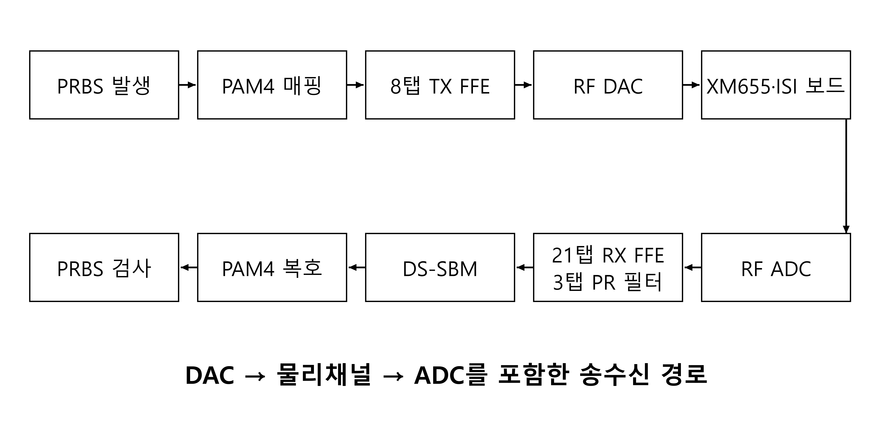

# Master’s Thesis | DS-SBM PAM4 Receiver Design and Verification (In Progress)

<!-- page-navigation:top -->

  
  

<!-- /page-navigation:top -->

<a href="README.md#page-top">한국어</a>

I designed a **DS-SBM reduced-state sequence detector** to reduce the hardware cost and sequential dependency of PAM4 detection. Two survivor branches per reduced state feed a hierarchy of segment metric matrices. I integrated the detector into a ZCU208 DAC–physical-channel–ADC transceiver and evaluated the recovered bits.

**Master's thesis · Manuscript being finalized**

[Detector architecture](docs/architecture.md#page-top) · [RFSoC implementation](docs/implementation.md#page-top) · [Measurements and resources](docs/validation.md#page-top)

## Key results

**Measurement conditions:** ZCU208, XM655 and ISI board; 4&nbsp;GS/s; estimated total path loss of about 41&nbsp;dB at 2&nbsp;GHz. Each pattern uses its selected PR response.

| Evaluation | Result |
|---|---|
| Physical transceiver | **8-Gb/s PAM4** |
| PRBS7 BER | **< 10⁻⁷** |
| PRBS15 BER | **< 2×10⁻⁶** |
| Detector resources vs. RS-ACS | **35.7% fewer LUTs; 22.5% fewer FFs** |

## Why combine survivor branches and segment matrices

A memory-2 PAM4 full-state detector has 16 states and 64 transition candidates per symbol. DS-SBM uses four reduced states and propagates two selected branches per state. These eight branches supply alternatives for subsequent path-cost comparisons.

To avoid a long chain of symbol-by-symbol path-metric updates, a 32-symbol frame is divided into eight four-symbol segments. Their 4×4 metric matrices are composed hierarchically. Each entry retains one selected path with recovery information; the final matrix is combined with the incoming four-element PM vector. [Operation diagrams and worked examples](docs/architecture.md#page-top)

## Integrated RFSoC validation

The transceiver includes an 8-tap TX FFE, a 21-tap RX FFE, a separate 3-tap PR filter and a PRBS checker. Keeping the RX FFE and PR filter separate allows the PR response to be varied while maintaining the channel-equalization settings. [Signal path and PS control](docs/implementation.md#page-top) · [BER contours and FPGA resources](docs/validation.md#page-top)

## Related work

Thesis title: *A PAM4 Reduced-State Maximum-Likelihood Sequence Detector Using Dual Survivors and Segmented Metric Matrices*

The thesis develops the DS-SBM operation, RFSoC integration and physical-channel results from my [A-SSCC 2026 transceiver research](https://github.com/yunjuhyeong0916-glitch/jhyun/blob/main/projects/zcu208-pam4-dsp-portfolio/README.en.md#page-top). The follow-up DP-SMM architecture, which retains two paths per matrix entry, is documented in the [journal project](../dp-smm-journal/README.en.md#page-top).

<!-- page-navigation:bottom -->

  
  
  

<!-- /page-navigation:bottom -->
