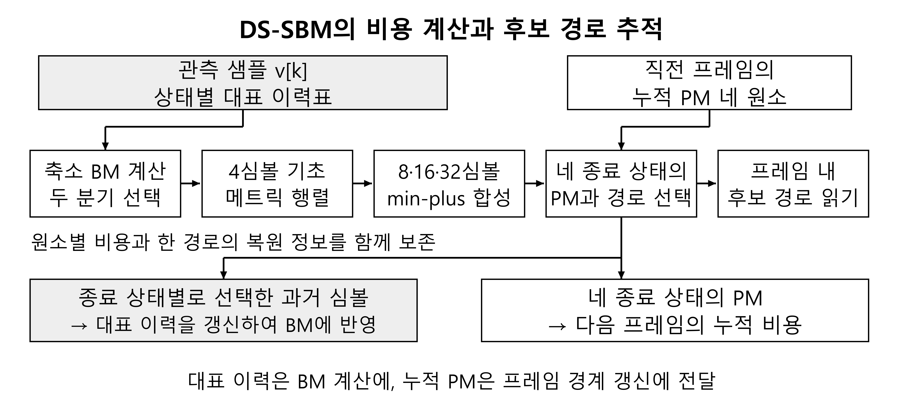
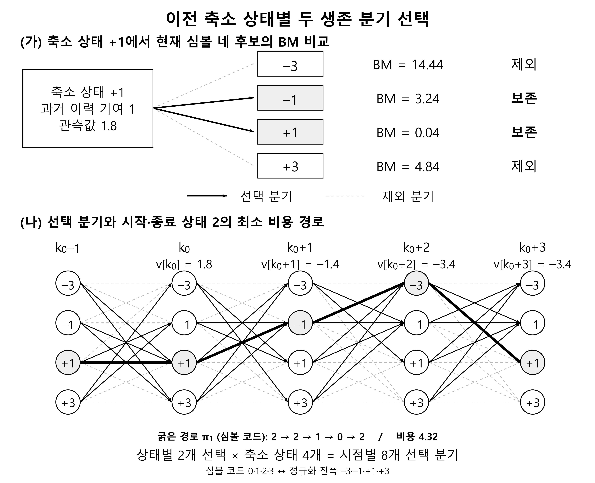
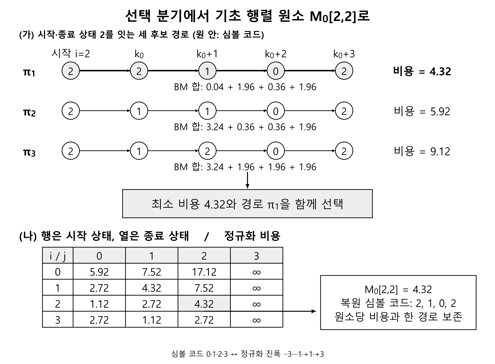
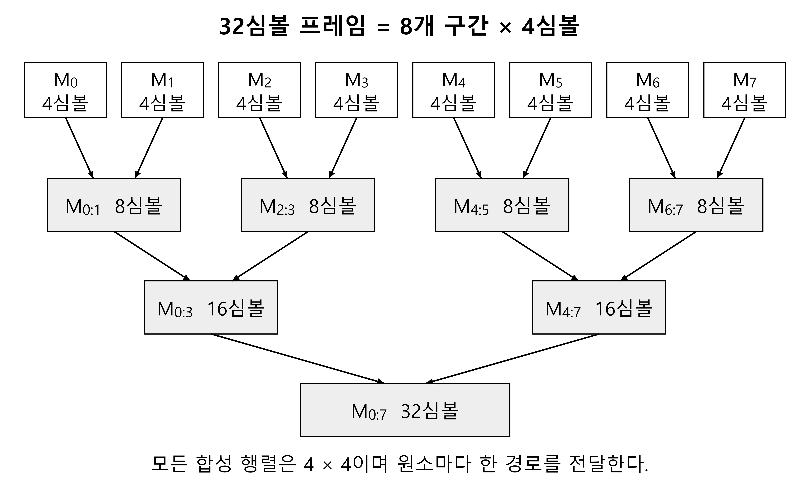
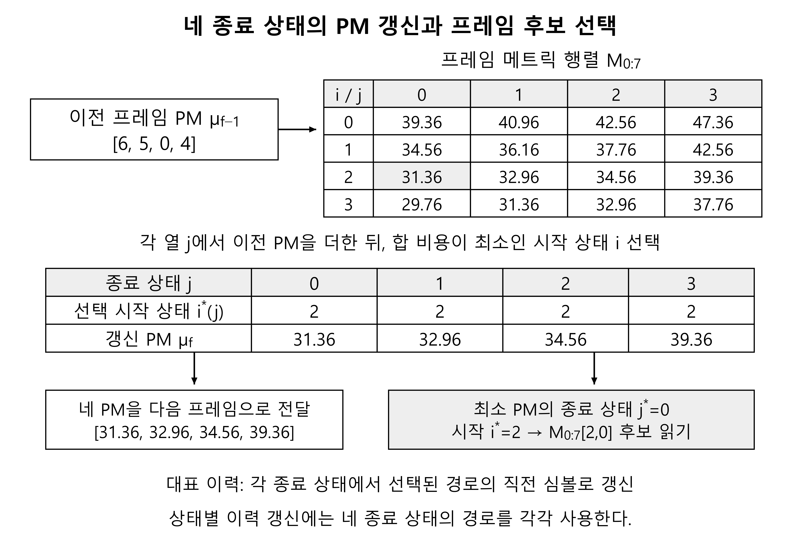
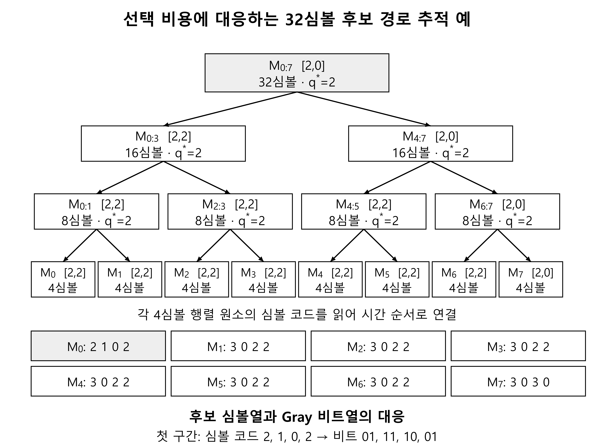

# DS-SBM 검출 구조와 동작

<!-- page-navigation:top -->

  
  

<!-- /page-navigation:top -->

[RFSoC 구현](implementation.md#page-top) · [측정·자원 결과](validation.md#page-top) · [MLSD 개념](https://github.com/yunjuhyeong0916-glitch/jhyun/blob/main/docs/concepts/mlsd.md#page-top)

## 분기 선택에서 프레임 판정까지

관측 샘플과 후보의 예상값 사이의 제곱거리를 BM으로 계산합니다. 기초 구간의 비용을 먼저 구한 뒤, 합성한 프레임 행렬에 이전 프레임의 누적 PM을 결합합니다. 비용을 선택할 때 해당 심볼열의 복원 정보도 함께 전달합니다.

## 네 축소 상태에서 두 생존 분기 전파

기억 길이 2의 PAM4 전체 상태는 직전 두 심볼을 구분하는 16상태입니다. DS-SBM은 직전 심볼을 기준으로 네 상태로 묶고, 생략한 과거 심볼의 기여를 상태별 대표 이력으로 계산합니다. 해당 프레임의 기초 비용을 계산하는 동안에는 같은 대표 이력표를 사용합니다.

각 이전 축소 상태에서 현재 심볼의 네 후보를 비교해 비용이 작은 두 분기를 남깁니다. 그림의 관측값 1.8 예에서는 BM 0.04와 3.24의 분기가 선택됩니다. 네 상태에서 두 개씩, **심볼당 여덟 활성 분기**를 다음 경로 구성에 전달합니다.

## 4심볼 기초 행렬의 원소에 한 경로 저장

선택한 분기로 구성할 수 있는 4심볼 경로를 시작·종료 축소 상태별로 비교합니다. 각 4×4 행렬 원소에는 최소 비용의 **한 경로와 복원 정보**를 보존합니다. 상태별 두 생존 분기와 행렬 원소별 한 경로는 서로 다른 단계의 선택입니다.

비용 4.32의 경로가 기초 행렬에 저장되는 예

시작·종료 상태를 코드 2로 고정한 예입니다. 세 후보의 네 BM을 더해 4.32·5.92·9.12를 얻고, 비용이 가장 작은 심볼 코드열 2·1·0·2의 복원 정보를 저장합니다.

## 여덟 기초 행렬을 32심볼 프레임으로 합성

왼쪽 구간의 종료 상태와 오른쪽 구간의 시작 상태가 같은 연결 후보의 비용을 더합니다. 네 중간 상태 가운데 최소 비용을 선택하는 min-plus 합성을 반복해 32심볼 프레임의 4×4 행렬을 만듭니다. 상위 단계에서도 원소별 한 경로와 그 경로를 선택한 중간 상태를 함께 전달합니다.

## 프레임 경계 PM 갱신과 후보 복원

프레임 행렬의 각 열에 이전 프레임의 네 PM을 더해 종료 상태별 최소 누적 비용을 구합니다. 선택한 시작·종료 상태와 합성 단계의 중간 상태를 따라가면 해당 비용을 만든 32심볼 후보를 복원할 수 있습니다. 종료 상태별로 선택한 경로의 직전 심볼은 다음 BM 계산의 대표 이력을 갱신하는 데 사용합니다.

PM 갱신과 32심볼 후보를 추적하는 수치 예제

이전 PM [6, 5, 0, 4]를 결합한 예에서 네 종료 상태의 PM은 [31.36, 32.96, 34.56, 39.36]입니다. 최소 PM의 종료 상태 0과 선택 시작 상태 2가 후보 복원의 출발점이 됩니다.

각 합성 단계에 저장한 선택 정보를 기초 행렬까지 따라가고, 여덟 구간의 네 심볼씩을 시간 순서로 연결합니다. 첫 구간의 2·1·0·2는 앞선 기초 행렬 예와 일치합니다.

| 처리 위치 | 보존·전달 정보 |
|---|---|
| 축소 상태별 분기 선택 | 상태별 두 분기, 총 8개/심볼 |
| 구간 행렬의 각 원소 | 최소 비용 한 개와 해당 경로의 복원 정보 |
| 프레임 경계 | 네 종료 상태의 PM과 선택 경로 정보 |
| 후속 BM 계산 | 종료 상태별로 갱신한 대표 이력 |

[수신 필터·프레임 연결·PS 제어](implementation.md#page-top) · [후속 DP-SMM과의 차이](../../dp-smm-journal/docs/ds-sbm-comparison.md#page-top)

<!-- page-navigation:bottom -->

  
  
  

<!-- /page-navigation:bottom -->
