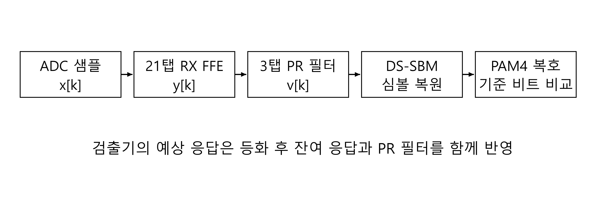
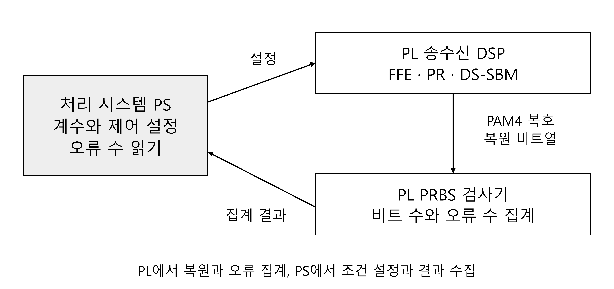
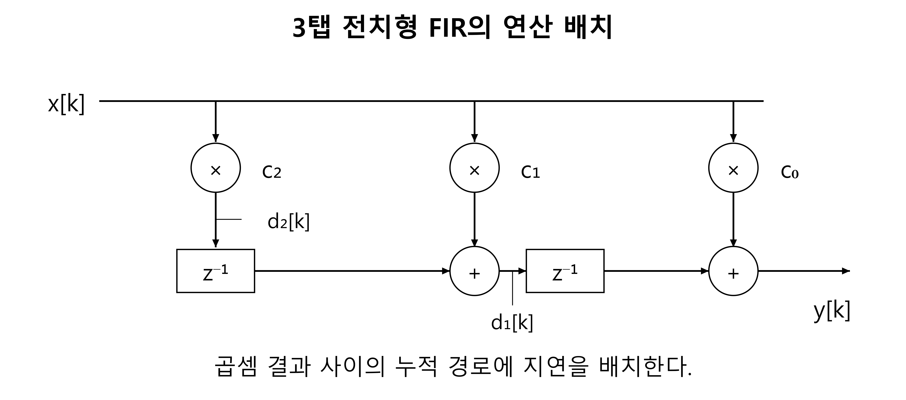

# RFSoC 송수신기 구현

<!-- page-navigation:top -->

  
  

<!-- /page-navigation:top -->

[DS-SBM 구조](architecture.md) · [측정·자원 결과](validation.md) · [Vitis 보드 구동 절차](https://github.com/yunjuhyeong0916-glitch/jhyun/blob/main/projects/zcu208-pam4-dsp-portfolio/docs/vitis-bringup.md)

## DAC에서 물리채널을 거쳐 검출기까지

FPGA가 생성한 PRBS를 PAM4로 매핑하고 8-tap TX FFE와 RF DAC로 출력합니다. XM655·ISI 보드를 거친 신호를 RF ADC로 받아 21-tap RX FFE, 3-tap PR 필터와 DS-SBM으로 처리합니다. 복원 심볼을 비트열로 변환한 뒤 기준 PRBS와 비교하므로 실제 변환기·물리채널·DSP가 연결된 복원 동작을 평가합니다.

## 채널 등화와 PR 응답을 따로 설정

RX FFE는 채널 왜곡을 보상하고, 뒤의 PR 필터는 검출기에 사용할 짧은 응답을 조절합니다. 두 필터를 분리해 RX FFE의 보상 조건을 유지하면서 PR 응답에 따른 BER 변화를 확인할 수 있도록 했습니다. 검출기의 예상값에는 송신 필터부터 PR 필터까지 거친 결합 응답의 세 커서를 사용합니다.

## 32심볼 병렬 데이터의 시간 순서 유지

한 프레임의 32개 레인은 연속된 직렬 심볼열의 위치를 뜻합니다. FFE와 PR 필터의 과거 샘플, 검출기의 대표 이력과 누적 PM을 프레임 경계 너머로 전달해 같은 시간 순서에 대응하도록 구성했습니다.

32심볼/클록, 입력 간격 II=1에서 4 Gsymbol/s를 처리하는 데 필요한 클록은 **125 MHz**입니다. PAM4의 심볼당 두 비트를 적용하면 비부호화 데이터율은 **8 Gb/s**이며, 실제 물리채널 평가는 변환기 4 GS/s 조건으로 수행했습니다.

## 고속 PL 처리와 PS 측정 제어

고속 필터·검출·PRBS 검사는 PL에서 처리하고, PS에서는 필터 계수와 PR 응답을 설정하고 결과를 수집합니다. 설정을 바꾼 뒤 기준 PRBS와 복원 비트의 시간 순서를 맞추고, 같은 유효 구간의 검사 비트 수와 오류 비트 수로 BER을 계산합니다.

JTAG 다운로드와 CLK104·RFDC 초기화, 계수 적용은 [Vivado·Vitis 구동 절차](https://github.com/yunjuhyeong0916-glitch/jhyun/blob/main/projects/zcu208-pam4-dsp-portfolio/docs/vitis-bringup.md)에서 볼 수 있습니다.

## 전치형 FIR의 자원 효과

필터 응답을 유지하면서 곱셈·덧셈과 지연 소자의 배치를 바꾸었습니다. 비교한 FIR 구현에서 직접형 대비 전치형의 LUT는 **79.93%**, CARRY8은 **70.95%** 감소했습니다. FF와 DSP를 포함한 [자원 비교표](validation.md#전치형-fir-구현-효과)도 함께 정리했습니다.

<!-- page-navigation:bottom -->

  
  
  

<!-- /page-navigation:bottom -->
