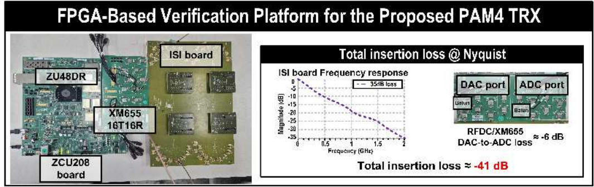
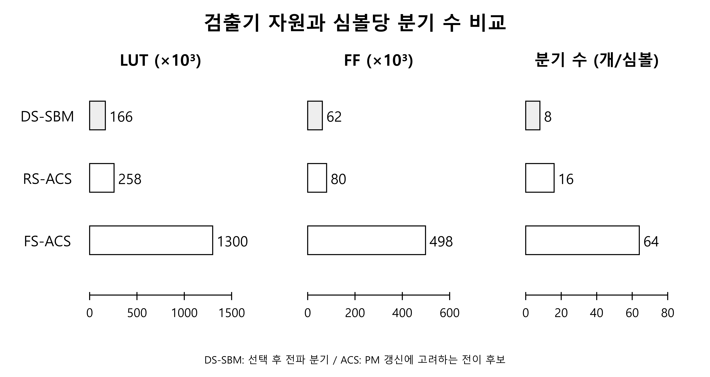
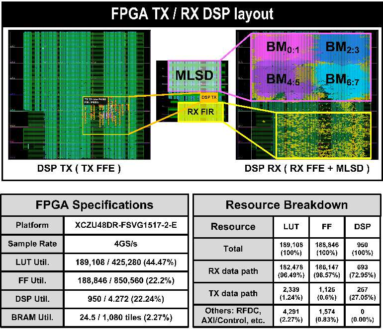

# DS-SBM 물리채널 측정과 FPGA 자원

<!-- page-navigation:top -->

  
  

<!-- /page-navigation:top -->

[DS-SBM 구조](architecture.md#page-top) · [RFSoC 구현](implementation.md#page-top) · [A-SSCC 프로젝트](https://github.com/yunjuhyeong0916-glitch/jhyun/blob/main/projects/zcu208-pam4-dsp-portfolio/README.md#page-top)

## 물리채널 측정 조건

ZCU208의 DAC에서 출력한 PAM4 신호를 외부 ISI 보드에 통과시킨 뒤 ADC와 수신 DSP로 복원했습니다. 4 GS/s는 PAM4 4 Gsymbol/s, 비부호화 **8 Gb/s**에 해당합니다. 2 GHz에서 ISI 보드 손실은 약 35 dB이며, 변환기·인터페이스의 추가 손실 약 6 dB를 포함한 전체 경로 손실은 **약 41 dB로 추정**합니다.

| 항목 | 조건·결과 |
|---|---|
| 플랫폼 | ZCU208·XCZU48DR, XM655, ISI 보드 |
| 신호·속도 | PAM4, 4 GS/s, 비부호화 8 Gb/s |
| 수신 구성 | 21-tap RX FFE → 3-tap PR 필터 → DS-SBM |
| PRBS7 | **BER < 10⁻⁷**, 선정 PR 응답 |
| PRBS15 | **BER < 2×10⁻⁶**, 선정 PR 응답 |

## PR 응답에 따른 BER 컨투어

두 축은 첫 번째·두 번째 후행 커서의 PR 설정 좌표이고, 색은 log₁₀(BER)를 나타냅니다. PRBS7과 PRBS15 모두 PR 응답의 설정 위치에 따라 BER이 달라집니다. 위 표는 각 패턴에서 선정한 PR 조건의 결과이며, 컨투어는 수신 경로에서 낮은 BER을 얻는 설정 영역을 보여 줍니다.

## 검출기 단독 자원 비교

| 검출 구조 | LUT | FF | 심볼당 분기 |
|---|---:|---:|---|
| **DS-SBM** | **166k** | **62k** | 선택 후 전파 8개 |
| RS-ACS | 258k | 80k | PM 갱신 전이 후보 16개 |
| FS-ACS | 1.3M | 498k | PM 갱신 전이 후보 64개 |

검출기 단독 집계에서 RS-ACS 대비 **LUT 35.7%·FF 22.5% 감소**를 확인했습니다. 분기 수는 선택 후 전달량과 ACS의 전이 후보를 각각 나타내며, 실제 회로 규모는 LUT·FF로 비교합니다. FS-ACS의 1.3M LUT는 대상 디바이스 용량을 넘는 회로 규모의 비교 기준입니다.

## 전체 송수신기 구현

TX·RX 필터, DS-SBM과 인터페이스·제어를 포함한 전체 송수신기의 자원입니다. 위 검출기 단독 비교와는 집계 범위가 다릅니다.

| 자원 | 사용량 | XCZU48DR 용량 대비 |
|---|---:|---:|
| LUT | 189,108 | 44.47% |
| FF | 188,846 | 22.20% |
| DSP | 950 | 22.24% |
| BRAM 타일 | 24.5 | 2.27% |

TX·RX 데이터 경로별 자원 분포

| 구분 | LUT | FF | DSP |
|---|---:|---:|---:|
| RX 데이터 경로 | 182,478 | 186,147 | 693 |
| TX 데이터 경로 | 2,339 | 1,125 | 257 |
| 기타 인터페이스·제어 | 4,291 | 1,574 | 0 |
| 합계 | 189,108 | 188,846 | 950 |

## 전치형 FIR 구현 효과

| 구현 | LUT | FF | DSP | CARRY8 |
|---|---:|---:|---:|---:|
| 직접형 | 28,155 | 1,030 | 926 | 2,547 |
| 전치형 | 5,650 | 937 | 932 | 740 |

직접형 대비 전치형의 LUT는 **79.93%**, FF는 **9.03%**, CARRY8은 **70.95%** 감소했습니다. DSP는 926개에서 932개로 0.65% 증가했습니다. 이 수치는 두 FIR 구현의 비교이며, 전체 송수신기의 감소율과 구분합니다.

## 학위논문에서 정리한 성과

축소 상태별 두 생존 분기와 구간 행렬 합성으로 검출 연산을 구성하고, 필터·변환기·물리채널을 연결한 **8-Gb/s PAM4 송수신 경로**에서 동작을 확인했습니다. 200 Gb/s 이상급 인터페이스에 활용할 DSP 검출 로직을 목표로 한 연구이며, 고속 공정 구현과 병렬도 확장은 후속 과제입니다.

[A-SSCC 논문 정보](https://epapers2.org/asscc2026/ESR/paper_details.php?paper_id=1351) · [DS-SBM 설계 구조](architecture.md#page-top) · [후속 Journal·DP-SMM 연구](../../dp-smm-journal/README.md#page-top)

<!-- page-navigation:bottom -->

  
  
  

<!-- /page-navigation:bottom -->
